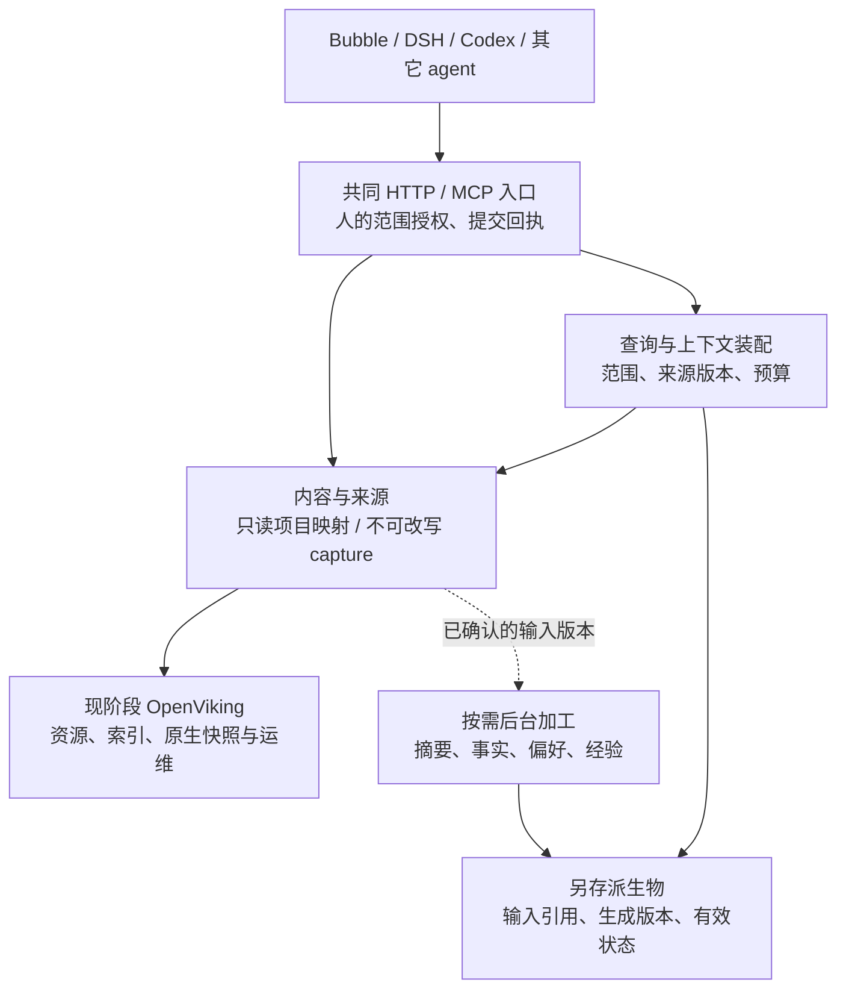

# 个人记忆基座：两仓源码研究后的架构建议

日期：2026-10-11。性质：架构咨询与后续探索建议，**不是已实施的新架构，也不把 ADR-0032 改为 accepted**。

阅读基线、分仓报告和探针见 [研究目录](../experiments/memory-source-study/README.md)。结论针对本仓的 S1–S3：一个人的多个 agent 共享内容；项目源文件只读；应用提交的正文不被再次改写。目标仍是家用 PC 上可部署、可接入的个人产品。

## 1. 推荐结论

**基本形状采用“人的内容仓库 + 另存的派生记忆 + 按任务取用的上下文”。当前继续使用固定版本 OpenViking 承接资源存储与检索，保留 `memory_base` 的共同入口；之后按具体任务借用 MemOS 的记忆加工能力。暂不同时部署两个完整记忆运行时，也不立即拆取两套底层存储。**

这延续已经确定的采用 → 使用中筛选扩充 → 产品计划 → 独立产品化路线。此次研究改变的是对产品边界的理解：OpenViking 已含记忆抽取与检索，MemOS 自身也含原文/记忆存储和检索，不能把两者天然视为“文件系统”和“操作系统”两个无重叠的积木。

我们最应该掌握的是：**每类数据的权威、允许修改它的主体、读取的版本、失败和过期行为**。目录树只是这些规则的一种表达。AI 降低了阅读和改造源码的成本，持久化格式、迁移、恢复、模型副作用和跨平台原生依赖仍需明确承担。

## 2. 源码带来的关键修正

### OpenViking 是带语义处理的资源系统

- VikingFS 同时接入文件后端、向量后端、ACL、嵌入与检索配置，并通过多个 mixin 组合资源操作、快照、搜索和同步。它提供了可用的底座，但不是与上层完全无关的 POSIX 文件系统。[VikingFS 组合](https://github.com/volcengine/OpenViking/blob/df32bf6e50a40843438f9491a26069ca4bd08f1f/openviking/storage/viking_fs/__init__.py#L55-L155)
- 上层也已有 session 归档/抽取和 context assembler，后者包含查询扩展、去重、正文预取、token 预算和可选 digest 改写。后续所需能力应先与这些现实现对照；MemOS 的价值需要落实到它特有的记忆模型或更合适的模块边界。[完整链路与配置](../experiments/memory-source-study/openviking.md)
- 普通 `resources` 文件与 `memory` namespace 具有不同处理语义。我们现用 `resources/captures`、`mode=create`、`vectors_only` 和 `raw=true` 是保护提交正文的实际边界；不能以后只改一个 URI 就接入自动记忆加工。[本仓实际调用](../memory_base/upstream.py)、[OpenViking 写入分析](../experiments/memory-source-study/openviking.md)
- 固定版本的 `HierarchicalRetriever` 实际执行一次全局候选检索，按 URI 去重，再可选重排；文件有层级不意味着检索算法会逐层递归探索。当前 `find(level=2)` 可继续承担文件级低成本候选发现。[检索实现](https://github.com/volcengine/OpenViking/blob/df32bf6e50a40843438f9491a26069ca4bd08f1f/openviking/retrieve/hierarchical_retriever.py#L149-L257)
- **向量集合不全部是可丢弃缓存**：ACL 的直接及继承状态也存于 context records。正文可重算向量，不代表删除整个数据库后权限仍能恢复。原生 pack 与文件快照也不能直接等同完整部署备份。[ACL 存储](https://github.com/volcengine/OpenViking/blob/df32bf6e50a40843438f9491a26069ca4bd08f1f/openviking/storage/acl.py#L277-L299)、[恢复边界分析](../experiments/memory-source-study/openviking.md)

此前“本地 watch 被框架拒绝”的表述需限定到已经测过的 **HTTP 本地路径/上传入口**。源码另有 native ResourceService/WatchScheduler 的本地路径处理；本轮没有实际验证它可完成我们的项目映射。无论 watch 是否可用，定期导入更新仍不同于直接读取源文件及证明源版本新鲜。这份补正不把旧 HTTP 探针改判为通过。[分入口说明](../experiments/memory-source-study/openviking.md)

当前安装包与 checkout 的 704 个共有 Python 文件归一化文本全部一致，避免只凭版本号猜测来源；原生构建产物未做此核对。[只读来源检查](../experiments/memory-source-study/provenance.json)

### MemOS Python 的核心对象是可加工的记忆单元

Tree 的图承担记忆正文、来源、状态和生命周期存储，并不只是从外部原文生成的关系索引；重组可以合并、归档节点。因此“把 MemOS 图直接接成我们的派生索引”需要重新约束写入与生命周期，不能仅换存储配置。[Python 链路与重组分析](../experiments/memory-source-study/memos-python.md)

也不能反过来说 MemOS 完全不能保存原传文本：Naive/General 的 `add` 可以绕过 `extract`；General 将 memory 正文随向量 payload 保存。区别在于它们的初始化仍构造 extractor LLM，MOSCore 更直接创建 chat LLM、MemReader、UserManager；关掉 scheduler 不等于得到纯存储内核。[General 构造与 add](https://github.com/MemTensor/MemOS/blob/a7367d07e55db61099f7b4e2c1108bc5831a24f3/src/memos/memories/textual/general.py#L28-L108)、[MOSCore 初始化](https://github.com/MemTensor/MemOS/blob/a7367d07e55db61099f7b4e2c1108bc5831a24f3/src/memos/mem_os/core.py#L43-L79)

产品 API 的异步 fast/fine 链路也不同于我们的“不可变原文先落库”：fast 先写入图，后台抽取 fine 后可以删除 fast/working 节点；`RawFileMemory` 保存的是解析/分块后的输入。版本功能默认关闭，已追踪路径中的增量/反馈版本由插件 hooks 承接，报告未找到可据以证明完整回滚的对应注册实现。方法名 `raw` 或 `version` 本身不能作为 S3 和恢复通过的证据。[具体调用与检查范围](../experiments/memory-source-study/memos-python.md)

它值得参考的能力是证据来源、结构化抽取、记忆冲突/合并、任务调度和反馈处理；大型 Python MOS/Tree 栈并不是我们当前 S1–S3 的必要前置。[模块及依赖报告](../experiments/memory-source-study/memos-python.md)

### MemOS Local 更接近 agent 经验加工器，且不是同一个 Python 内核

新版 Local 的 TypeScript core 被 OpenClaw、DSH、Hermes 适配器使用；另有旧 OpenClaw 实现和旧形态 `packages/memos-core`。本轮固定的是整个仓库的一次 main 快照，新版 manifest 为 `2.0.16-beta.1`，不能直接当作已选定的稳定模块包。[新版 package](https://github.com/MemTensor/MemOS/blob/a7367d07e55db61099f7b4e2c1108bc5831a24f3/apps/memos-local-plugin/package.json#L1-L27)、[实现关系](../experiments/memory-source-study/memos-local.md)

完整链路从会话/episode 到 trace、policy、world model、skill；会话文本会标准化/截断，正常 trace 入库之前有摘要/嵌入步骤，不是任意提交正文的无损原件库。默认 `lightweightMemory.enabled=true`，其余学习订阅器并不自动运行，不能把完整自进化当成默认行为。[默认配置](https://github.com/MemTensor/MemOS/blob/a7367d07e55db61099f7b4e2c1108bc5831a24f3/apps/memos-local-plugin/core/config/defaults.ts#L103-L105)、[轻模式分支](https://github.com/MemTensor/MemOS/blob/a7367d07e55db61099f7b4e2c1108bc5831a24f3/apps/memos-local-plugin/core/pipeline/deps.ts#L244-L267)

它按 agent framework/profile 定义私有和共享可见性；`public` 通常仍限于同 framework，`hub` 才跨 framework。我们需要人的共享记忆，因此其 namespace 不能原封不动变成产品所有权或服务端授权模型。[实际过滤谓词](https://github.com/MemTensor/MemOS/blob/a7367d07e55db61099f7b4e2c1108bc5831a24f3/apps/memos-local-plugin/core/runtime/namespace.ts#L107-L171)

还应区分**阅读所得知识**与**完成任务所得经验**。Local 的 L2/skill 依赖 trace value、reward、不同 episode 和真实工具/反馈信号，不能把一篇文章直接伪装成任务轨迹去启动全链学习。阅读简报适合先做简单的原文消费者；反复发生的开发任务才适合验证经验归纳。[L2 筛选与归纳](https://github.com/MemTensor/MemOS/blob/a7367d07e55db61099f7b4e2c1108bc5831a24f3/apps/memos-local-plugin/core/memory/l2/l2.ts#L50-L183)

Local 报告的 SQLite 隔离探针还表明：被检查的正文编辑路径会同步 FTS，但保留旧向量。这个有限结果提醒我们，即使采用其代码，派生版本与失效仍需自己的合同验证；它不是对完整 Local 产品做过运行评测。[探针与限制](../experiments/memory-source-study/memos-local.md)

## 3. 我们的职责边界



图表示逻辑职责，不要求再拆微服务。当前 gateway + OpenViking + 为并发稳定性独立的串行嵌入进程可以继续使用；有具体学习任务时再启动相应 worker。

| 职责 | 我们掌握什么 | 当前可复用什么 | 不应顺带扩大的范围 |
|---|---|---|---|
| 共同入口与权限 | 人的共同空间；agent 身份作来源和能力边界；路径范围；统一错误 | `memory_base` HTTP/MCP 和宿主注册 | 让所有 agent 重新拥有独立主库；把 skill 当授权 |
| 内容与来源 | 原文、只读源、对象引用、版本、新鲜度、幂等回执 | OpenViking resource 原样写读与资源操作 | 启用可能加工原文的 memory 写入通道；搭建另一份可独立编辑的项目主库 |
| 派生加工 | 固定输入版本、产物另存、失败可见、源变化失效 | 优先验证原生处理；按任务选取 MemOS reader/Local pipeline 的边界 | 整体接入第二套 Cube/图/SQLite 原文权威及重叠索引 |
| 查询与上下文 | 先圈定授权范围，再召回、原文核验、预算装配；原文与推断区分 | 当前 find；先验证原生 assembler，任务经验确有需要再择需 Local retrieval/filter | 无证据地新增图、复杂 rerank、三层学习或整套调度平台 |
| 运维与产品化 | 固定依赖、安装、迁移、权限恢复、数据出口 | 现安装器；上游版本/导出工具；现评测资产 | 把上游的文件备份误称完整产品恢复 |

“单一权威”约束的是内容归属和读写规则，**不强制只有一个 agent 能写入**。多个 agent 可追加不同对象；当前一个 gateway 进程是实现幂等临界区的部署边界。以后若增加 gateway 副本，应升级跨进程唯一创建/事务保障；若新增修改，应采用每对象的预期版本检查。无需先引入全局单写者选举。

## 4. 三类持久数据必须分清

| 数据 | 权威与修改规则 | 恢复与过期规则 |
|---|---|---|
| **提交原文 / 项目源文件** | capture 的提交正文由基座保存；项目文件仍由对应 repo 负责，基座只读。Bubble 生成并提交的总结就是本次原文，并不等同完整文章或视频 | capture 保持原文哈希；项目读取记录真实内容版本，不能只记 Git commit 而忽略未提交变更 |
| **摘要、抽取事实、画像、向量等产物** | 来自原文的加工结果，另存并指向输入；候选推断可以自动生成或修订 | 输入版本变化就过期/重算；生成版本、模型/配置和产物哈希留痕，索引落后不能冒充当前 |
| **权限、来源登记、人工纠正、采纳/拒绝、有效偏好状态** | 人或受授权管理流程确认的规则；其权威不由 LLM 重算取代 | 属于必须保存的状态，不能随“重建派生索引”丢弃；凭据单独安全保存或重发 |

**派生不等于可随时丢掉。** 已采纳的偏好、人工反馈、产物引用和处理记录，不能指望日后换一个模型还能完全生成相同结果。向量通常可以重算，已确认状态需要恢复。MemOS 的状态化记忆及 OpenViking 的 context ACL 都说明了这一点。

路径、对象身份和版本分别解决“在哪里”“是哪一个”“是哪次内容”。原有 capture URI 应继续有效；按日期/类型组织逻辑视图，不必把原文移到新目录来获得筛选能力。采用视图仍需按规范对象地址授权，别名不能扩大权限。

日期按已经约定的本人接触日与 Asia/Shanghai 解释。当前 `created_at` 是接收时间，尚未实现接触日路径，不能拿它直接满足“今天看的文章/视频”。改名的项目文件首期显式登记，不做昂贵的自动身份推断。

### 项目映射先解决“当前性”，再讨论高级加工

推荐下一步做一个只读来源适配：登记一份项目根目录和授权子树；按需扫描/读取实际文件；引用带内容哈希；搜索索引持有处理时的哈希，源变化后明确过期并追平。来源不可达必须报错，不能拿旧导入快照充当当前源，也不能自动按“已删除”清除其历史。

源读取与变更检测应由确定性代码负责，LLM 不判断文件是否变化。可以利用 native watch 减少延迟，也必须有周期扫描/读取时校验作补偿；**watch 是触发机制，源版本才是正确性依据**。不为这一点搭建通用 POSIX 挂载、双向同步或分布式文件系统。

也不能把真实 repo 直接接到可写 local mount 后让原生 semantic 流程运行：摘要 sidecar 的输出必须放在派生空间，不能写回只读来源。只读是实际执行权限，不是给目录起一个名字。

搜索所需的内部正文快照如无法避免，应明确为带源版本的只读处理输入，不提供第二编辑入口。是否保留历史证据快照及其保留期限，属于后续具体方案；不能将此建议解释为已改变 ADR-0032 D7 的项目权威规则。

## 5. 后续保留的最小合同

以下是现接口的演进合同；按真实需求逐项增加，不要求今天实现全部工具或通用插件框架：

```text
Ref = {id/uri, canonical_path, revision, source_ref}
get(ref, expected_revision?) -> original + actual_revision + source_state
append(path, original, request_id) -> ref + persisted_receipt + index_state
list(scope, cursor) -> refs + effective_scope + completeness
search(query, scope, limit) -> refs/snippets + indexed_revision + coverage
derive(source_refs, processor_version) -> job_id + output_refs + job_state
status(scope) -> source/index/job_state
```

- `list/get` 不以向量成功为前提；搜索是发现候选，原文证据回到相同版本。读取时已变化就提示变化/重查，避免旧片段被新正文无声支持。
- 写入成功表示正文及回执已保存；索引可 pending。加工失败不抹掉已接受的原文，重复任务用固定输入版本和 processor version 去重。
- 新鲜度和覆盖只对 `effective_scope` 承诺。授权失败、来源失联、索引落后和真正的无命中分别表达；候选为零不能证明知识不存在。
- 派生任务只获得读取授权输入和创建派生物的权限。它不能覆盖 capture 或项目文件。跨来源派生物继承至少与全部输入同样严格的读取限制，撤权/删源后需要重新核验。
- 新 agent 接入仍要验“它实际什么时候查、怎样读、失败时怎么处理”；工具注册和存储共享并不自动令 agent 懂得使用记忆。

初期用进程内模块完成这些逻辑。现成的上游任务与状态能满足合同就复用；仅当它不能持久保留某类任务/反馈时，再为这些状态加一个本地 SQLite。不要为了“操作系统”比喻预先引入 Redis、RabbitMQ、图数据库或 Kubernetes。

如果最终采用 Local 的整块经验 worker，可以保留其 SQLite 状态库，并通过 `RetrievalRepos`、typed candidates、context packet 及加工入口适配原文引用。它的 `StorageDb` 暴露 SQL 和 better-sqlite3 原生 handle，不能直接用文件系统接口替换；两种存储各管其对象，比强行统一底层 API 更容易维护。[真实接缝与伴随依赖](../experiments/memory-source-study/memos-local.md)

## 6. 怎样选择性使用两个仓库

| 能力 | 推荐方式与时机 | 切开时必须保留的边界 |
|---|---|---|
| OpenViking resource 存储、检索与原生运维 | **现在继续整套固定服务复用**，由薄入口限制能力。近期先补映射、新鲜度、范围和恢复证据 | 真实 source/capture 的权威；显式处理模式；身份/ACL/control plane；索引与正文版本 |
| OpenViking 原生摘要/抽取 | 有真实摘要/事实任务时，先隔离验证现能力是否够用；仅对派生空间运行 | 原文禁止改写、输入版本引用、调用成本、失败/恢复 |
| MemOS Local 的处理 runner、repo ports、检索过滤 | **较优先的源码探索对象**；取一个真实任务做隔离适配。可整块复用，不限于抄几段算法，但应选定明确版本 | 输入事件、episode 边界、repo 类型、LLM/embedder、prompt/config、namespace 改为人级范围、产物版本失效、关联测试 |
| MemOS Python reader / conflict / feedback | 确实需要其专门能力再验证；必要时独立 worker 环境，或提取有边界的模块 | 图状态与 memory items、source/schema、factory/import 依赖、批处理及后台线程、迁移和测试 |
| MemOS Cube、Tree 全库、完整 scheduler | 当前不接；有图关系或多类记忆调度的实际任务再单独论证 | 是否形成第二权威；怎样从原文重建、保存确认状态、授权过滤和退出导出 |
| RAGFS / 原生存储层直接裁剪 | 最后产品计划阶段评估，不能因 Rust 子目录相对独立就先拆 | Python binding、原生构建、平台 wheel、向量/ACL 协作、snapshot与恢复、上游升级和许可来源 |

每块复用记录：**功能目的、固定 SHA/发布版本、入口和数据格式、外部依赖、测试/探针、许可声明、维护归属、回退方式**。选择代码时沿公开入口、存储格式和写入副作用查依赖，不能只沿 import 图裁剪。codegraph 能辅助这一工作，AOCI 不应成为当前理解与探针的前置。

两套 Python 产品也不宜直接塞进现运行 venv：固定 MemOS manifest 约束 `openai<2`，现 `memory_base` 锁定 OpenAI 2.54。这是静态依赖约束冲突，未做安装兼容性测试；需要该能力时先在独立 worker 或受控提取中验证。[MemOS 依赖](https://github.com/MemTensor/MemOS/blob/a7367d07e55db61099f7b4e2c1108bc5831a24f3/pyproject.toml#L40-L56)、[本仓约束](../memory_base/constraints.txt)

许可本轮仅记录源码标注：OpenViking Python/root 为 AGPL，`crates/LICENSE` 及 RAGFS manifest 标 Apache-2.0；MemOS Python manifest 为 Apache-2.0，Local manifest 为 MIT。**不据子目录标签推断整个裁剪产物的许可**；最终产品计划需按实际纳入文件、依赖和上游来源清单核实。ADR-0032 的 owner 已接受的许可方向继续保留，不在这份研究中重新解释法律义务。

## 7. 推进顺序与结束条件

| 顺序 | 下一项可交付的纵向切片 | 结束条件 |
|---|---|---|
| 1 | **一个只读项目接入 + 源变化可见**，先解决已知来源新鲜度问题 | 源增/改/删、未提交变化、源失联；当前读取与检索版本可解释；恢复源后自动追平；不写原 repo |
| 2 | **按日期/类型/项目圈定范围 + 正确授权** | 明确接触日；列举/搜索/读取/写入同一范围；至少两个 agent 的允许/拒绝路径实测。现网关把所有调用转成 upstream 的 personal/gateway 身份，扩范围时必须补足身份/策略映射 |
| 3 | **无人值守历史与完整恢复** | 自动检查点；内容、身份/ACL、来源登记、必要确认状态的清单；异盘备份；空数据根恢复并重验权限和内容哈希。同机重启证据不替代此验收 |
| 4 | **一个派生任务**，优先“今天的阅读简报”或明确偏好抽取 | 基于已筛范围的固定原文版本；产物另存可追溯；失败可重试；输入变化过期；第二个 agent 可读且不会误当原文 |
| 5 | **裁剪与独立产品计划** | 已知使用瓶颈、模块来源清单、部署/迁移/维护/退出方案，再决定哪些上游服务换为自有模块 |

前三项完成内容仓库的需求；第四项才进入学习探索。后续不要求人持续审查每个版本、每条自动推断，而是让系统自动留下来源、状态和历史，人按需要纠正；纠正本身是持久输入。

当前真实部署已经证明 capture 的可接入、原样保存、跨宿主读取和重启保留；**项目映射、细范围、新鲜度、完整异盘恢复仍未完成**。旧引擎保持冻结，现评测与消费者接缝继续用。本轮新增的只是研究文档与只读证据，没有改变生产数据、服务或既有实验结论。[已完成的真实验收与剩余边界](../experiments/memory-base-live/README.md)

## 8. 后续需要实证的四件事

1. native watch 在当前 Windows、所选 root/权限和重启条件下到底怎样运行；它能否减少来源适配工作，而不把“映射”变成第二份可编辑正文。
2. OpenViking 资源更新/重建/pack 恢复是否在我们的身份和范围下完整保持 ACL 与源版本；不以“有 API”作为通过证据。
3. 选出的一个 Local runner 能否使用外部的规范原文引用，脱离宿主内部会话事件稳定运行，并正确处理撤权、源变化和向量失效。
4. 实际中文项目资料及文章/视频任务的召回是否够用；在缺陷出现前，不为 README 的检索或学习术语换引擎。

这些是可做的小型隔离探针，后续按切片执行即可；不再展开一轮无限的整体架构讨论。
